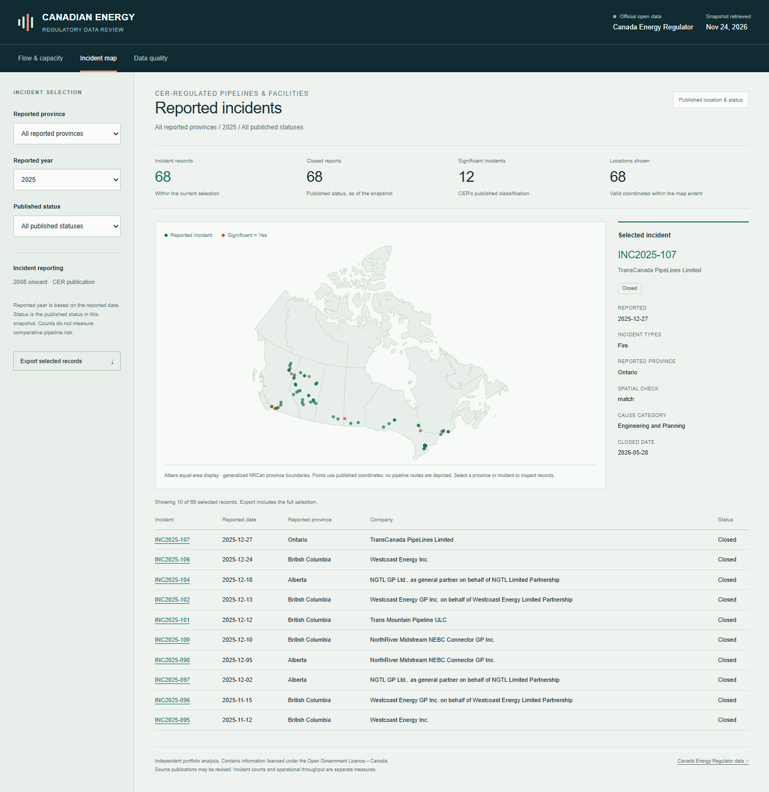
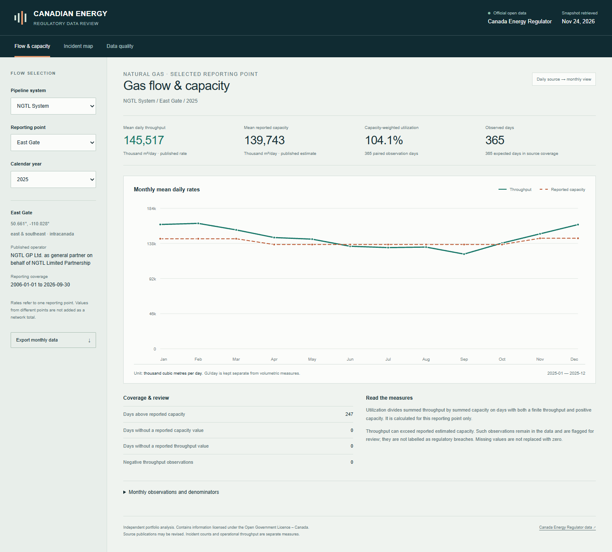

# Canadian Energy Regulatory Data Analysis

[](https://github.com/Michaelhoang8/cer-energy-regulatory-analysis/actions/workflows/validate.yml)

**279,055 daily gas-flow observations · 44 reporting-point combinations · 2,039 incidents · Power BI, Excel, SQL, Python and GIS**

An independent analysis using real [Canada Energy Regulator data](https://open.canada.ca/data/en/dataset/dc343c43-a592-4a27-8ee7-c77df56afb34) and [Natural Resources Canada boundaries](https://open.canada.ca/data/en/dataset/443e98f0-a461-45ab-8fa2-57645b3efbb5). It connects data collection, profiling, reconciliation, spatial assessment and reporting in a reproducible project. The focus is regulatory data quality and interpretation, with original source values and their limitations preserved.



## Review the project

| Deliverable | Contents |
|---|---|
| [Offline interactive report](reports/dashboard.html) | Download the repository and open this file in a browser. Selected-point flow/capacity, incident map, quality rules, filters and CSV exports. No server or account required. |
| [Native Power BI project](powerbi/native/CER_Energy_Analysis.pbip) | Three editable pages, five tables, five relationships and 15 DAX measures. Open in Power BI Desktop and select **Refresh**. |
| [Excel review workbook](excel/cer-energy-review.xlsx) | Monthly flow calculations, province-level incident review and an editable quality-review queue; native formulas, charts and tables. |
| [Findings](reports/findings.md) | Calculated results, follow-up recommendations and interpretation limits. |
| [Recorded walkthrough](docs/recordings/walkthrough.mp4) | Continuous automated browser demonstration of the actual report. This is report interaction, not manual development footage. |
| [Screenshots](docs/screenshots/README.md) | Desktop/mobile browser captures, plus [native Power BI](docs/screenshots/native-powerbi.md) and [Excel views](excel/README.md). |
| [Role alignment](docs/role-alignment.md) | Concrete artifact links and examples relevant to regulatory data analysis, SQL, GIS and information management. |

## Sources and scale

| Source | Snapshot and role |
|---|---|
| [CER pipeline throughput and capacity](https://open.canada.ca/data/en/dataset/dc343c43-a592-4a27-8ee7-c77df56afb34) | Seven daily natural-gas systems: NGTL, Canadian Mainline, Foothills, Alliance, Westcoast, TQM and M&NP. 279,055 observations, 2006-01-01 through 2026-09-30. |
| Brunswick gas series, same catalogue | 206 monthly observations retained separately and excluded from daily coverage. |
| [CER comprehensive incident publication](https://open.canada.ca/data/en/dataset/7dffedc4-23fa-440c-a36d-adf5a6cc09f1) | 2,039 distinct incidents; latest reported date 2026-10-22. Contains multiple energy products and regulated facilities. |
| [CER incident-map extract](https://www.cer-rec.gc.ca/open/incident/pipeline-incidents-data.csv) | Independently published file reconciled to the comprehensive extract by Incident Number. All 2,039 IDs and compared fields match. |
| NRCan province boundaries | 114 generalized polygon parts, grouped into 13 provinces/territories, in EPSG:4326. No licensed pipeline-route geometry is redistributed. |
| Historical CER methodology PDF | Optional unstructured-source extraction with six paraphrased rules and page-level provenance; [separate terms and reproducibility notes](docs/methodology-source.md). |

The reviewed snapshot was retrieved on **24 November 2026**. Original CSV/GeoJSON bytes, source URLs, hashes and encoding profiles are retained under `data/source`. Published files contain real observations, not synthetic portfolio data.

## What the analysis handles

- **Frequency and grain:** daily observations are separated from the monthly Brunswick feed. Monthly model rows preserve daily counts and paired measurement sums.
- **Missing data:** 7,842 missing capacity values and 1,602 missing throughput values remain missing. Utilization uses matched dates with finite throughput and positive capacity.
- **Interpretation:** 12,891 observations exceed published estimated capacity; five throughput observations are negative. They remain visible for review rather than being clipped, silently removed or labelled breaches.
- **Metadata quality:** the gas dictionary mixes volumetric and energy units in a description; the incident dictionary reverses coordinate descriptions. Original metadata and the chosen interpretation are documented.
- **Reconciliation:** incident IDs, selected fields and normalized reporting dates are compared across two official publications. Unknown province labels are preserved consistently, including a published Maine record.
- **GIS:** 1,996 incident locations match the reported Canadian province in the generalized polygons; 43 receive another review status. Approximate points and simplified borders do not establish a location error.

For the default **NGTL East Gate / 2025** view, 365 daily observations produce **104.13% capacity-weighted utilization**. CER explains that reported capacity is estimated and can be exceeded. This result is not a regulatory compliance finding. The report does not add interconnected measurement points into a misleading network throughput total. [CER's explanation](https://www.cer-rec.gc.ca/en/data-analysis/facilities-we-regulate/look-pipeline-flow-capacity/natural-pipeline-flow-capacity.html).



## Reproduce the analysis

The core build uses **Python 3.13 and its standard library**. All required data inputs are included; a normal rebuild works offline. The optional PDF and Excel builders have separate dependencies documented below.

```bash
python scripts/verify_source.py
python src/build.py
python src/build_powerbi.py
python -m unittest discover -s tests -v
python src/compare_powerbi.py
python scripts/verify_evidence.py
python scripts/verify_excel.py
```

The pipeline creates `data/energy.sqlite` locally, with raw daily measurements, source-row lineage, conflicting-key quarantine, incident audit records and SQL reporting views. Generated databases are excluded from Git. The five model CSVs form a two-fact star schema; `FactFlow` contains 9,171 monthly point groups and `FactIncident` contains 2,039 incident records.

Power BI imports embedded CSV snapshots through Power Query, avoiding machine-specific file paths. Rates are guarded by `HASONEVALUE(DimPoint[PointId])`; aggregate record counts can be viewed across points, while mean rates and utilization remain blank for multiple points. See [model and native-engine verification](powerbi/README.md).

For candidate updates, use `python scripts/fetch_sources.py`. It writes to a separate candidate directory rather than replacing reviewed inputs. Profile, reconcile and review the candidate before promotion. The [governance notes](docs/governance.md) describe source lifecycle, access scope, retention and retrieval.

Optional artifact workflows:

- [Excel](excel/README.md): `scripts/build_excel.mjs`, using `@oai/artifact-tool`. The shipped workbook is ready to review; rebuilding it requires that runtime.
- [Methodology extraction](docs/methodology-source.md): `src/extract_methodology.py`, with `requirements-source.txt`. Full source PDF and full extracted text are excluded from Git under separate reproduction terms; the pinned URL/hash and derived rule evidence are provided.
- Browser evidence: install `requirements-media.txt`, an appropriate Playwright browser and FFmpeg, then run `python scripts/capture_report.py`.

## Verification

- **31 tests** cover source encoding, null/zero denominators, signed flows, duplicate/conflicting keys, calendar gaps, province normalization, spatial holes/boundaries, model relationships and totals.
- **44 native Power BI checks** reconcile 783 point/year groups, 144 province/year groups and all 15 measures with independently generated SQL/Python results. [Results](reports/powerbi_validation_results.json).
- **76 Excel checks** verify formulas, weighted totals, edited review statuses and missing/zero denominators. The saved workbook contains 201 formulas, three tables and two charts. [Evidence](reports/excel_validation.json). It was calculated and rendered with the artifact engine; desktop Microsoft Excel was not executed.
- **Seven browser capture checks** verify displayed values; seven actual browser screenshots and a continuous walkthrough have a [capture manifest](docs/recordings/capture_manifest.json).
- GitHub Actions rebuilds the analysis on Windows and Linux, checks generated outputs and validates evidence hashes. Native Desktop execution is a separate local validation whose saved results are reconciled in CI.

## Scope and licence

This independent portfolio project does not imply Government of Canada employment, endorsement or access to internal CER systems. Incident counts have no exposure denominator and are not company safety rankings. Flow and incident reporting populations are not treated as a causal join. Read the [methodology](docs/methodology.md) before interpreting either.

**Contains information licensed under the Open Government Licence – Canada.** [Data licence](https://open.canada.ca/en/open-government-licence-canada/). Code is [MIT licensed](LICENSE); source data and the historical methodology document retain their separate terms.
