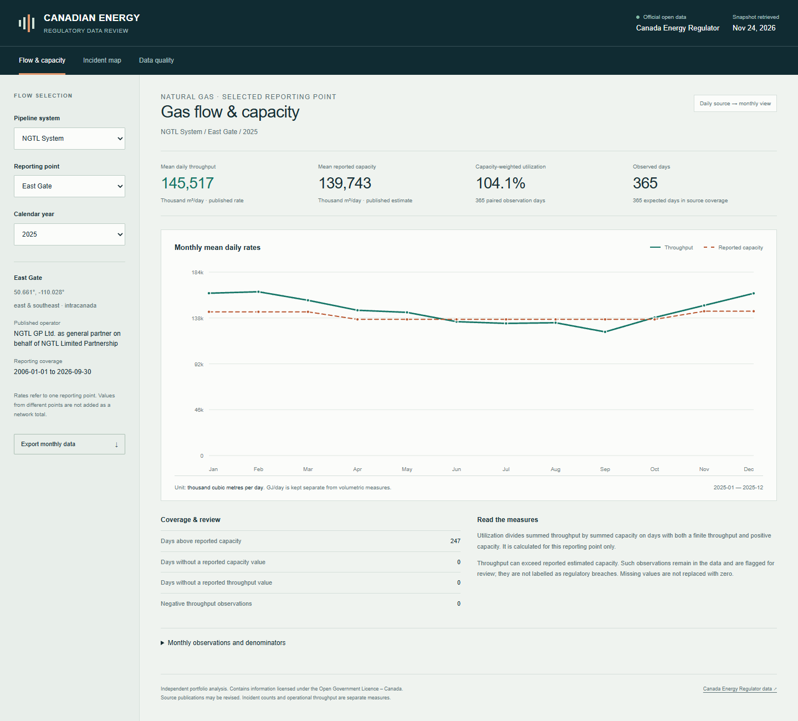
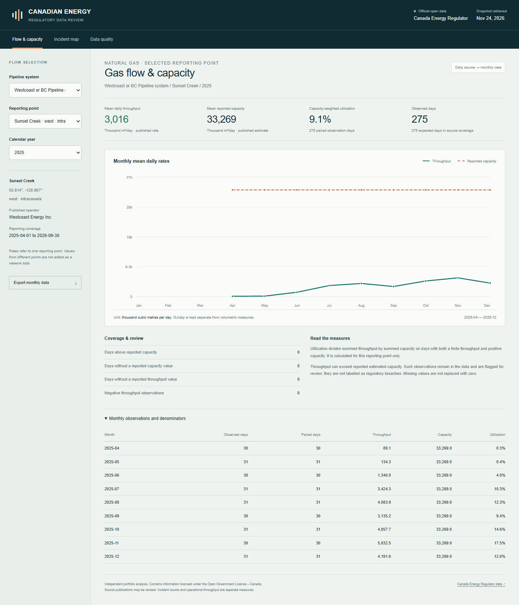
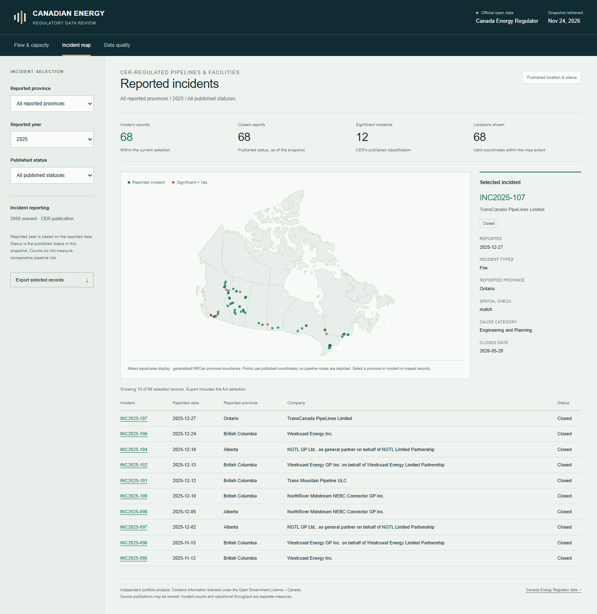
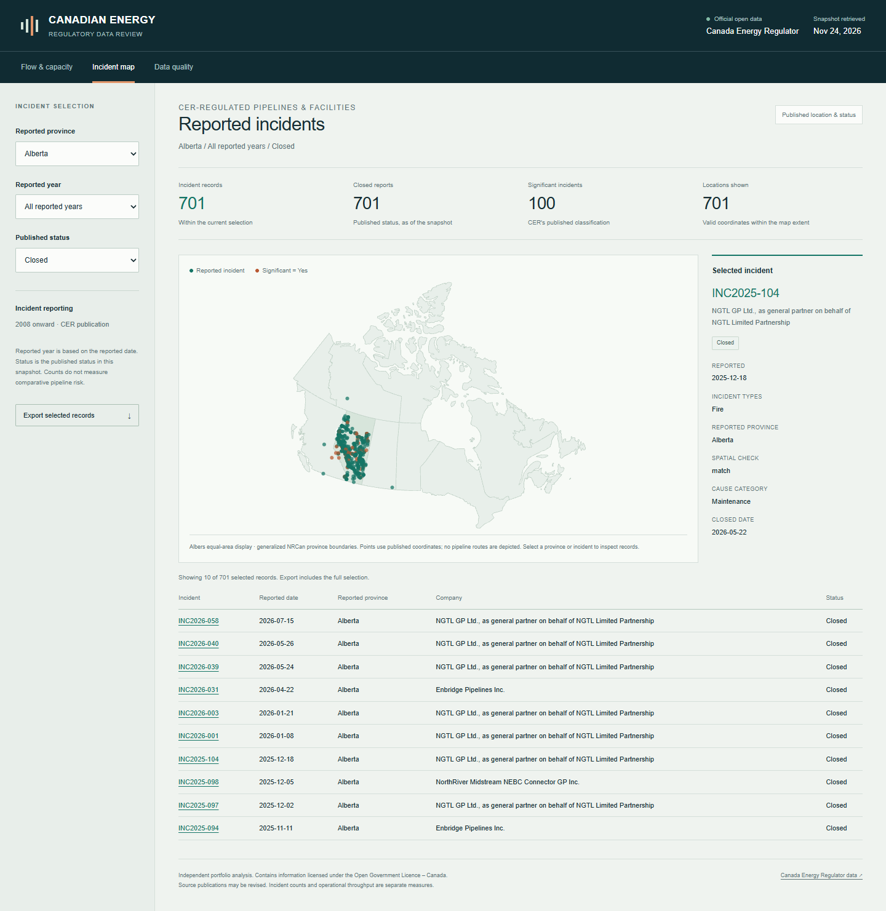
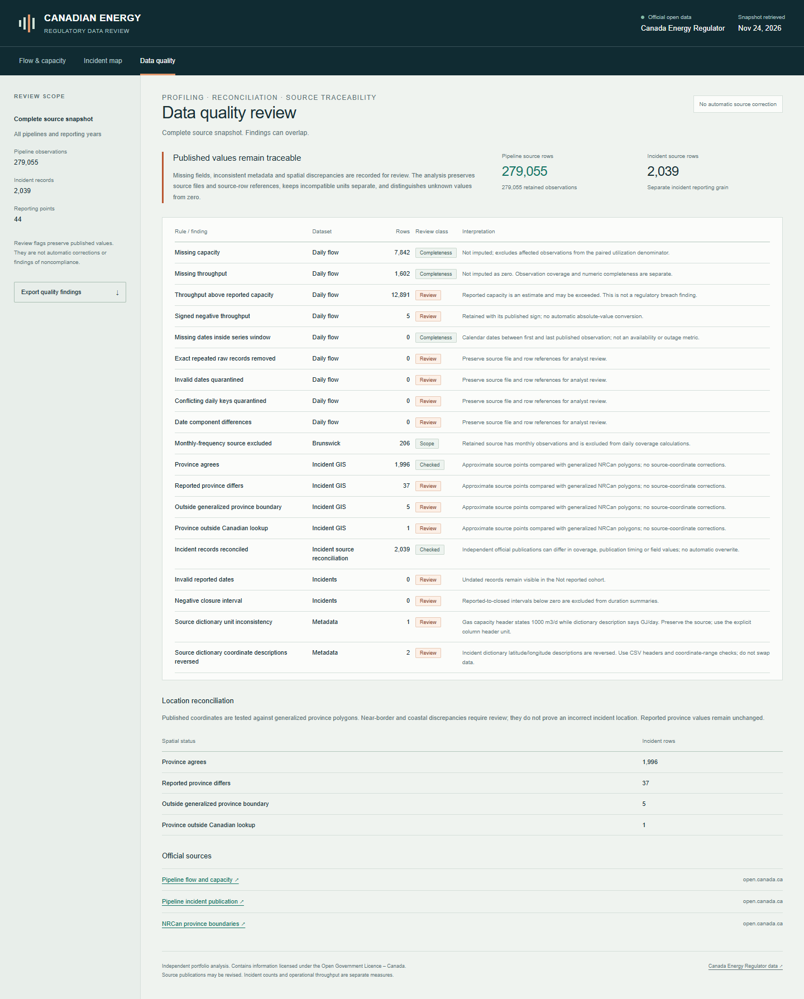
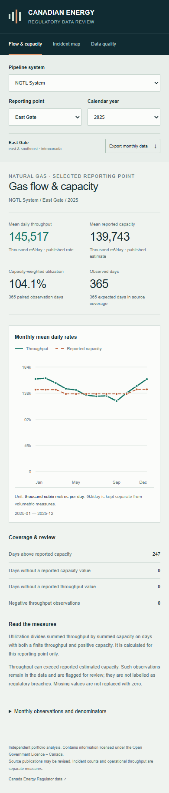
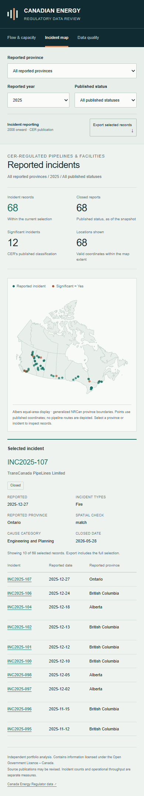

# Browser report screenshots

Actual browser captures of the generated offline report. See the separate [native Power BI captures](native-powerbi.md) and [Excel workbook views](../../excel/README.md).

## 01-flow-capacity.png

Natural gas throughput and reported capacity at the default reporting point and year.

## 02-point-review.png

Another reporting point, with the monthly data table expanded for denominator review.

## 03-incident-map.png

Reported incident locations on openly licensed NRCan province boundaries.

## 04-alberta-review.png

Alberta incident records across reported years, filtered to published Closed status.

## 05-data-quality.png

Full-snapshot source profiling, spatial checks and provenance.

## 06-mobile-flow.png

Working flow report at a 390-pixel viewport.

## 07-mobile-incidents.png

Incident map and record inspection at a 390-pixel viewport.

