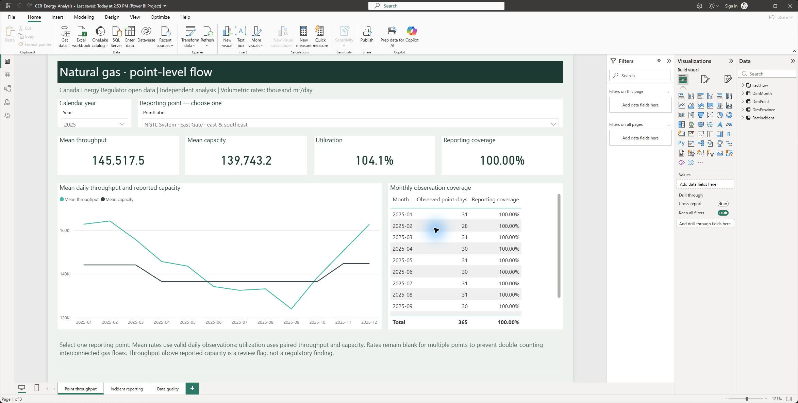
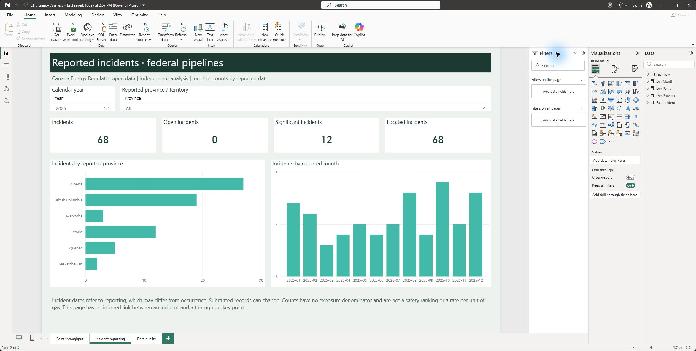
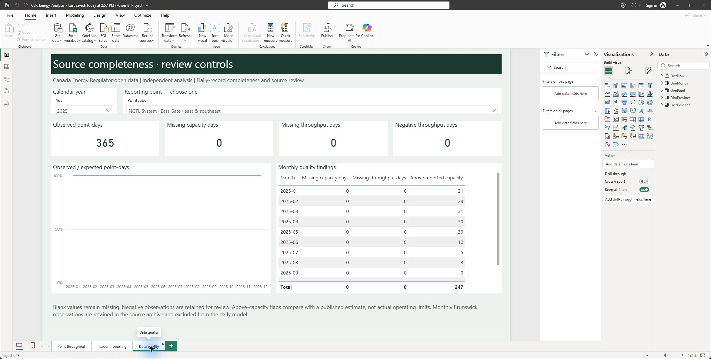

# Native Power BI

Unaltered captures of `CER_Energy_Analysis.pbip` running in Power BI Desktop after refreshing its embedded model. The separate interactive HTML report supplies the offline geographic map; these screenshots show the native Power BI pages.

## Selected reporting point — 2025

## Incident reporting — 2025

## Data quality — 2025

[Native DAX validation](../../reports/powerbi_validation_results.json) reconciles 783 point/year groups and 144 province/year groups, including global single-point guards and all 15 explicit measures. Screenshots demonstrate the loaded report; the numerical checks provide reconciliation evidence.
