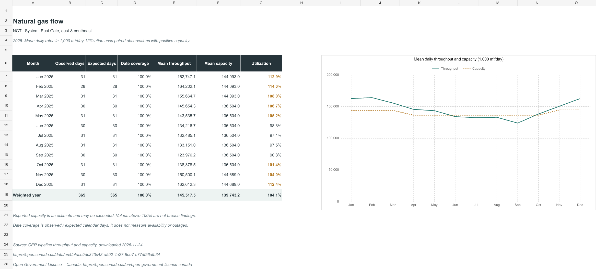
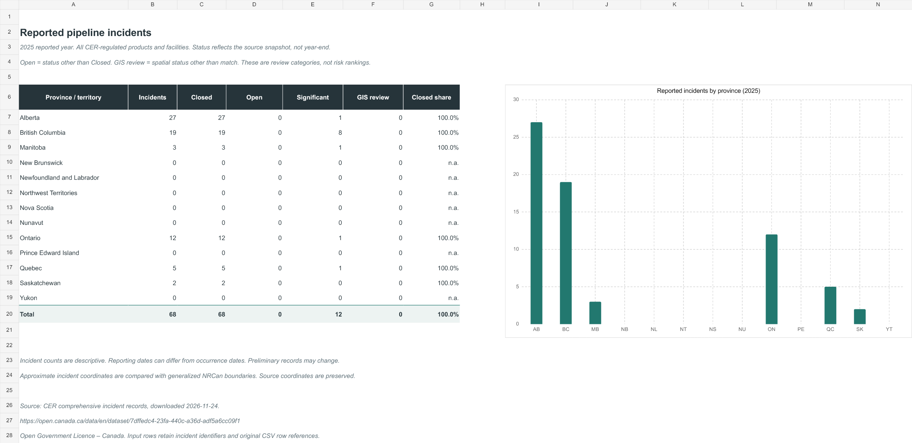
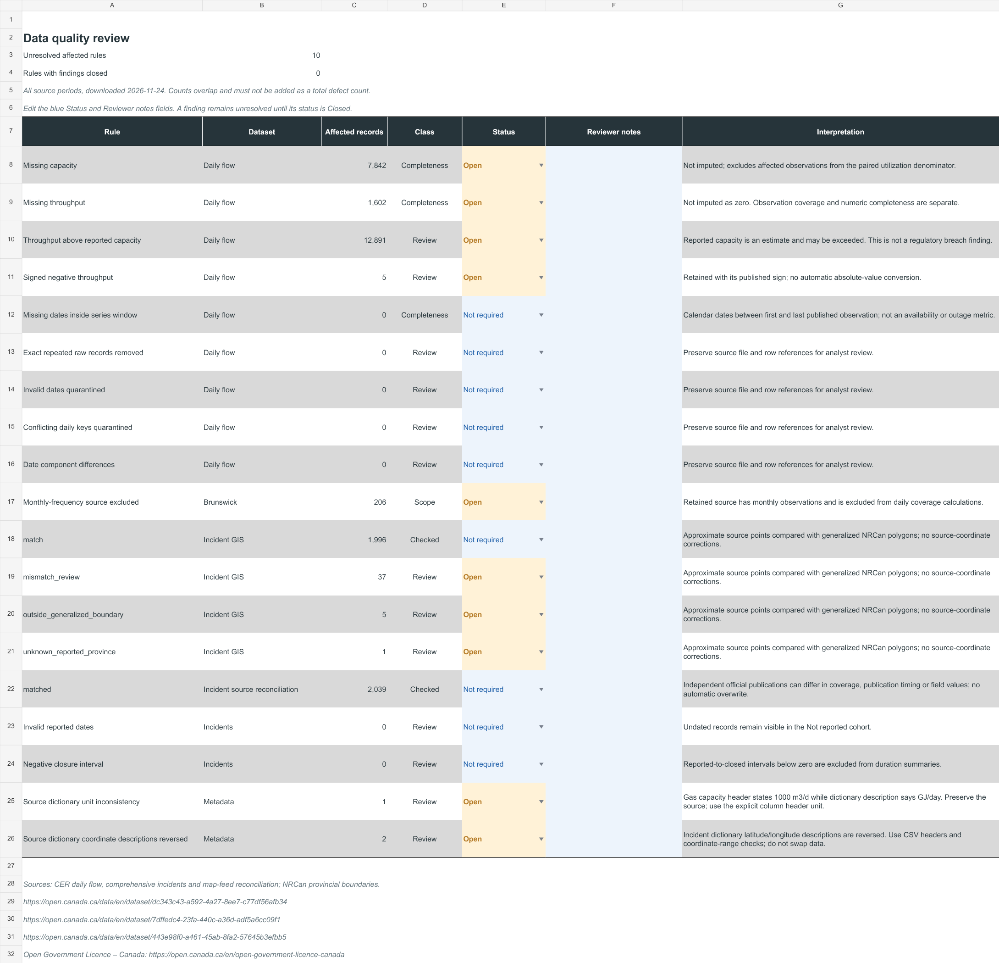

# Excel review workbook

[Download the workbook](cer-energy-review.xlsx). It contains three working sheets built from the committed source snapshot:

- **Flow review:** 2025 monthly NGTL East Gate observations, daily rate means, date coverage and paired utilization. The annual utilization divides the annual sum of paired daily throughput rates by the matching sum of capacity rates. It does not average monthly percentages. Retained input sums and day counts sit below the results.
- **Incident review:** province and territory counts calculated with native Excel formulas from all 68 incidents reported in 2025. The input records retain incident identifiers, reported dates, source row references, status and spatial review results. Status reflects the downloaded snapshot, not the end of 2025. The incident population includes all CER-regulated products and facilities, separately from the selected gas flow point.
- **Quality review:** all 19 quality rules across the complete source period. Edit the blue Status and Reviewer notes fields. Ten rules with affected records initially require review. A blank status remains unresolved, and closing a finding updates the count. These fields record local review work and do not alter CER records.

Each input section cites the official data source and the Open Government Licence – Canada. Geographic comparisons use approximate incident locations and generalized NRCan boundaries. A mismatch requests review; it does not correct a source location or establish a regulatory breach.

## Rebuild

First run the repository data pipeline. Then execute the builder with a Node.js runtime that has the authorized `@oai/artifact-tool` package available. The data pipeline does not require this optional workbook-authoring dependency.

```powershell
# Set this to the node_modules directory returned by the workspace dependency loader.
$env:NODE_PATH = '<artifact-tool node_modules directory>'
node scripts/build_excel.mjs
python scripts/verify_excel.py
```

The script derives the selected point and year from `reports/dashboard_data.json`, overwrites the generated workbook and screenshots, and resets local review fields to their initial states. Save a separate copy if retaining manual review work. To review another point or year, change the payload selection and rebuild; the delivered workbook itself is a fixed 2025 point review.

## Verification

`reports/excel_validation.json` records the exact payload SHA-256, 76 calculation and edit-response checks, selected inputs, compact formula inspections and an error scan. The verification script also records the exported workbook and screenshot hashes and checks the selected point label against the original UTF-8 payload. Checks include independently calculated monthly and weighted annual metrics, province counts, changed/blank review status, zero/blank capacity denominators and missing expected-day counts. Test changes are restored before export.

The exported workbook was checked for three worksheets, 201 native formulas, three native tables, two range-backed charts, a native review-status dropdown, and no cached formula errors. Chart ranges and the solid/dashed line colors were verified in the XLSX XML. All three sheets and both input sections were rendered and visually inspected. The workbook was generated and recalculated with `@oai/artifact-tool`; desktop Microsoft Excel was not run.






